<p align="center">
  
</p>

<p align="center">
  <a href="#-about-me">ABOUT</a>
  &nbsp; ◈ &nbsp;
  <a href="#-stack">STACK</a>
  &nbsp; ◈ &nbsp;
  <a href="#-activity">ACTIVITY</a>
  &nbsp; ◈ &nbsp;
  <a href="#contact">CONTACT</a>
</p>

<p align="center">
  <sub>◈ SYSTEM ONLINE &nbsp; | &nbsp; DEVELOPER PROFILE &nbsp; | &nbsp; STATUS: LEARNING</sub>
</p>

---

## 🧠 About Me

<p align="center">
  
</p>

<p align="center">
  <a href="mailto:Anilkbishnoi07@gmail.com">✉️ Email</a>
  &nbsp; ◈ &nbsp;
  <a href="https://github.com/ianilbishnoi">⌘ GitHub</a>
</p>

---

## ⚙️ Stack

<p align="center">
  <a href="https://www.python.org/">
    
  </a>
  &nbsp;
  <a href="https://www.typescriptlang.org/">
    
  </a>
  &nbsp;
  <a href="https://git-scm.com/">
    
  </a>
  &nbsp;
  <a href="https://www.linux.org/">
    
  </a>
</p>

<p align="center">
  <sub>TOOLS I USE ◈ TECHNOLOGIES I'M WORKING WITH</sub>
</p>

---

## 📡 Currently Learning

<details>
  <summary><b>⌘ Open learning log</b></summary>

  <br />

  ```text
  anil@github:~$ learning --current

  Data Structures & Algorithms
  Machine Learning fundamentals
  Data analysis and model evaluation
  Software engineering

  anil@github:~$ _
  ```

</details>

---

## 🔥 Activity

<p align="center">
  
</p>

<p align="center">
  
</p>

<p align="center">
  <picture>
    <source
      media="(prefers-color-scheme: dark)"
      srcset="https://raw.githubusercontent.com/ianilbishnoi/ianilbishnoi/output/github-contribution-grid-snake-dark.svg"
    />
    <source
      media="(prefers-color-scheme: light)"
      srcset="https://raw.githubusercontent.com/ianilbishnoi/ianilbishnoi/output/github-contribution-grid-snake.svg"
    />
    
  </picture>
</p>

---

## ⌘ Contact

<p align="center">
  <a href="mailto:Anilkbishnoi07@gmail.com">
    
  </a>
  &nbsp;
  <a href="https://github.com/ianilbishnoi">
    
  </a>
</p>

<p align="center">
  <sub>LEARNING BY BUILDING ◈ IMPROVING THROUGH PROBLEM SOLVING</sub>
</p>
