  

  
  
  

---

## 🧠 About Me

class Anil:
    def __init__(self):
        self.role = "Developer in the making"
        self.learning = ["Python", "Machine Learning", "Data"]
        self.currently = "Learning, building, shipping"
        self.open_to = ["Collaborations", "Internships", "Open Source"]

📫 **Contact:** [Anilkbishnoi07@gmail.com](mailto:Anilkbishnoi07@gmail.com)

---

## ⚙️ Tech Stack

  

---

## 🔥 Activity

  

  

